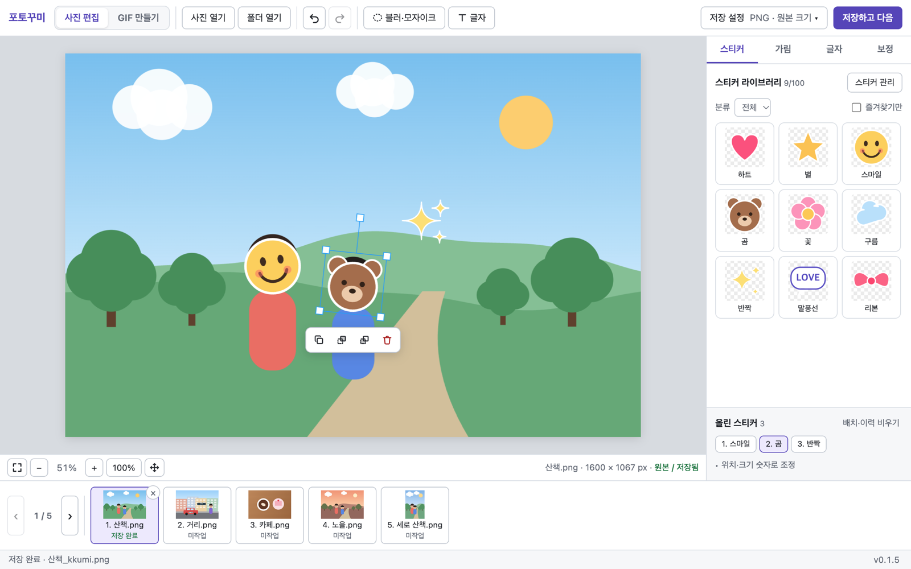
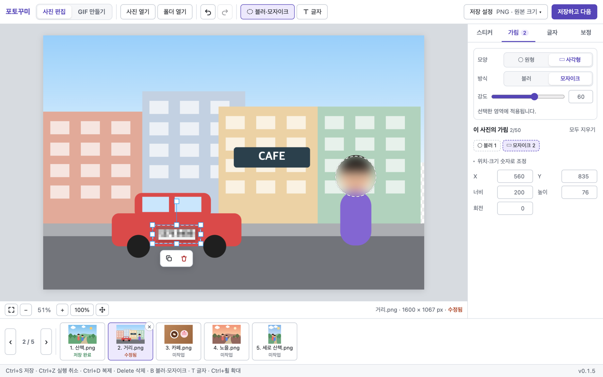
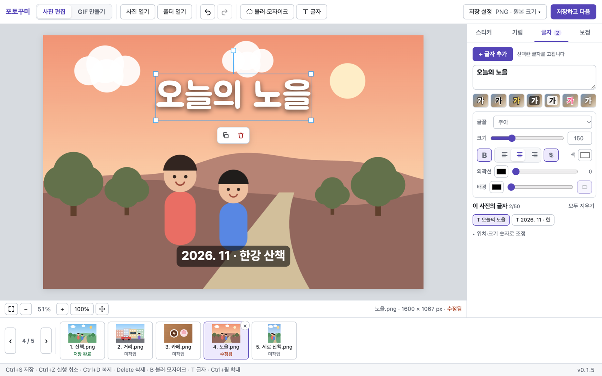
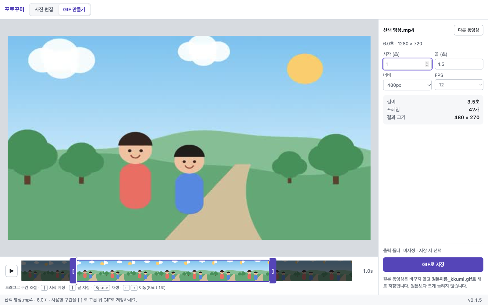

  

<h1 align="center">포토꾸미</h1>

  <b>내 스티커로 꾸미고, 다음 사진으로.</b> 
  블로그·SNS에 올릴 사진에 스티커를 붙이고, 가릴 곳은 가리고, 크기를 맞춰 저장하는 Windows 앱

  <a href="https://github.com/minipaper/photokkumi/releases/latest"><b>⬇ Windows용 다운로드</b></a>

## 이런 분께 맞아요

- 아이 사진이나 지인 사진을 올릴 때 **얼굴을 귀여운 스티커로 가리고** 싶은 분
- 사진 수십 장을 **한 장씩 꾸며서 빠르게 저장**해야 하는 분
- 차량 번호판·간판·주소처럼 **보이면 안 되는 부분을 블러나 모자이크로** 가려야 하는 분
- 전문 편집 프로그램은 너무 복잡하고, **열고 → 붙이고 → 저장하고 다음**이면 충분한 분

## 주요 기능

| | |
|---|---|
| 🐱 **기본 스티커** | 고양이·토끼·양·너구리 얼굴이 정면·옆·뒷모습 등 7방향으로 들어 있어 얼굴 방향에 맞춰 가릴 수 있고, 하트·반짝이·별·꽃·화살표·마스킹 테이프 같은 꾸미기 스티커도 있습니다. 필요 없는 건 지워도 됩니다. |
| 🧸 **내 스티커 라이브러리** | 투명 PNG를 한 번 등록해 두면 계속 남습니다. 분류·즐겨찾기로 정리하고, 끌어 놓기로도 추가할 수 있습니다. 백업·복원도 됩니다. |
| ✋ **클릭해서 붙이고 바로 조절** | 스티커를 클릭하면 사진 위에 올라갑니다. 끌어서 옮기고, 모서리로 크기를, 위 핸들로 회전을 조절합니다. 한 사진에 여러 개, 겹침 순서·복제·삭제도 됩니다. |
| 🔤 **글자 넣기** | 사진 위에 제목·날짜·설명을 씁니다. 앱에 든 한글 글꼴 15종(프리텐다드·본고딕·나눔고딕·주아·검은고딕·나눔손글씨 등)과 내 PC에 설치한 글꼴을 고르고, 크기·색·외곽선·배경 상자·그림자를 조절합니다. 자주 쓰는 스타일은 한 번에 적용됩니다. |
| 🫥 **블러·모자이크** | 원형 또는 사각형으로 그려서 가립니다. 그려 둔 영역은 다시 클릭해서 옮기거나 강도를 바꿀 수 있습니다. |
| 🎨 **간단 보정** | 밝기·대비·채도·색온도를 조절하고, 같은 값을 모든 사진에 한 번에 적용할 수 있습니다. |
| 📐 **블로그 크기로 저장** | 원본 크기 그대로 또는 가로/세로 사진별 길이를 정해 JPG·PNG로 저장합니다. 위치 정보(GPS) 같은 사진 정보는 지웁니다. |
| ⏭ **저장하고 다음** | 저장이 끝나면 다음 사진으로 넘어갑니다. 아래쪽 사진 목록에서 사진마다 `미작업·수정됨·저장 완료`를 보여 줍니다. |
| 🎞 **동영상 → GIF** | 휴대폰·카메라로 찍은 MOV·MP4에서 원하는 구간만 골라 GIF로 만듭니다. (ffmpeg 설치 필요, 아래 참고) |
| 🔄 **자동 업데이트** | 새 버전이 나오면 앱 오른쪽 아래에 알려 줍니다. 누를 때만 내려받고, 저장 안 한 편집이 있으면 먼저 물어봅니다. |

## 설치

1. [최신 릴리스](https://github.com/minipaper/photokkumi/releases/latest)에서 `PhotoKkumi-Setup-x.y.z.exe`를 내려받아 실행합니다.
2. 처음 실행할 때 **"Windows의 PC 보호"** 창이 뜰 수 있습니다. 개인이 만든 앱이라 코드 서명을 하지 않아서 그렇습니다. **추가 정보 → 실행**을 누르면 됩니다.
3. 설치 후에는 새 버전이 나올 때 앱이 알려 주므로 다시 내려받을 필요가 없습니다.

- 지원: Windows 10/11 (64비트)
- 인터넷 연결 없이도 모든 편집·저장 기능이 동작합니다.

## 사용 순서

1. **사진 열기** 또는 **폴더 열기**로 사진을 불러옵니다. 탐색기에서 창으로 끌어 놓아도 됩니다.
2. 기본 동물 스티커를 바로 쓰거나, 오른쪽 **스티커 관리**에서 내 투명 PNG 스티커를 등록합니다. 등록은 처음 한 번만 하면 됩니다.
3. 스티커를 클릭해 사진에 올리고, 위치·크기·회전을 맞춥니다. 가릴 곳은 **블러·모자이크** 도구로 그리고, 설명은 **글자**로 넣습니다.
4. **저장 설정**에서 형식과 크기를 고르고 **저장하고 다음**을 누릅니다. 마지막 사진까지 반복합니다.

처음 저장할 때 결과를 넣을 폴더를 한 번 고르면, 이후에는 그 폴더에 `원본이름_kkumi.jpg`처럼 저장됩니다. 원본 사진은 절대 바뀌지 않고, 같은 이름이 있으면 덮어쓰지 않고 번호를 붙입니다.

### 단축키

| 키 | 동작 |
|---|---|
| `Ctrl+S` | 지금 사진 저장 (다음으로 넘어가지 않음) |
| `Ctrl+Z` / `Ctrl+Y` | 실행 취소 / 다시 실행 |
| `Ctrl+D` | 선택한 스티커·영역·글자 복제 |
| `Delete` | 선택한 스티커·영역·글자 삭제 |
| 방향키 / `Shift`+방향키 | 1px / 10px 이동 |
| `B` | 블러·모자이크 도구 켜기·끄기 |
| `T` | 글자 추가 |
| `Ctrl`+마우스 휠 | 확대·축소 |

## GIF 만들기를 쓰려면

GIF 변환에는 무료 프로그램 **ffmpeg**가 필요합니다. 앱에 넣지 않았으므로 한 번만 직접 설치해 주세요.

1. 시작 메뉴에서 **명령 프롬프트**(또는 PowerShell)를 엽니다.
2. `winget install Gyan.FFmpeg`를 입력하고 설치가 끝날 때까지 기다립니다.
3. 포토꾸미의 **GIF 만들기** 화면에서 **다시 찾기**를 누릅니다.

## 개인정보

- 사진과 스티커는 **내 컴퓨터 안에서만** 처리합니다. 어디에도 업로드하지 않습니다.
- 앱이 인터넷에 접속하는 것은 **새 버전 확인(GitHub)** 때뿐입니다.
- 등록한 스티커와 설정은 내 컴퓨터의 앱 데이터 폴더에 저장되며, 스티커 관리의 **백업**으로 ZIP 파일로 보관할 수 있습니다.

## 알아 두세요

- 지금은 **Windows 전용**입니다.
- 편집 중인 사진 목록과 스티커 배치는 앱을 끄면 이어지지 않습니다. 종료 전에 저장 여부를 물어봅니다.
- 문제나 제안은 [Issues](https://github.com/minipaper/photokkumi/issues)에 남겨 주세요.

---

### 개발자용 문서

빌드·테스트 명령, 설계 원칙, 단계별 구현 기록은 [docs/development.md](docs/development.md)와 [docs](docs/) 폴더에 있습니다. 배포·자동 업데이트 절차는 [docs/release.md](docs/release.md)를 보세요.

라이선스는 아직 정하지 않았습니다. 공개 저장소라도 코드·이미지 재사용 허가를 뜻하지 않습니다. 스크린샷의 사진과 스티커는 설명용으로 직접 그린 합성 이미지입니다. 앱에 기본으로 들어 있는 동물·꾸미기 스티커는 ChatGPT 이미지 생성으로 만들었습니다.

앱에 들어 있는 글꼴은 모두 [SIL Open Font License 1.1](https://openfontlicense.org) 글꼴이며, 각 글꼴 폴더에 라이선스 원문을 함께 넣었습니다: 프리텐다드(길형진), 수트(SUNN), 나눔고딕·나눔명조·나눔손글씨 펜·붓(네이버), 본고딕·본명조(Noto Sans/Serif KR, Google·Adobe), 고운돋움·고운바탕(류양희), 검은고딕(Zess Type), 도현·주아(우아한형제들), 동글(류양희), 개구(The Gaegu Project Authors). 목록과 처리 방법은 [docs/text-overlay.md](docs/text-overlay.md)에 있습니다.
